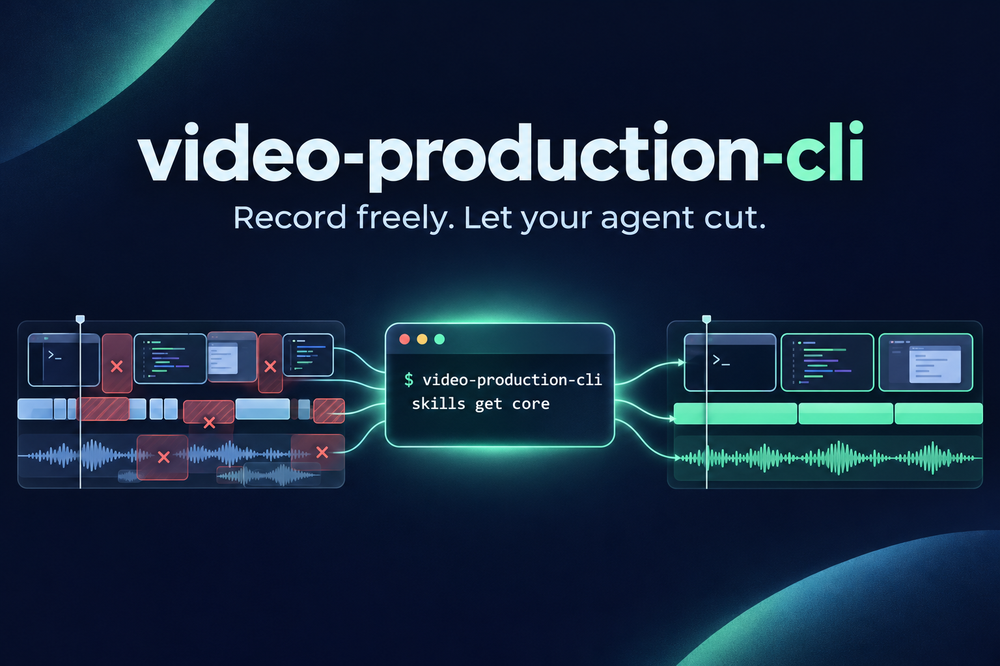

<div align="center">



# Record freely. Let your agent cut.

**Turn raw screencasts into edited videos with an AI agent and a CLI.**

Remove false starts, retakes and dead time. Check the joins. Review a preview. Render from the source.

[Get started](#get-started) · [Give it to your agent](#give-it-to-your-agent) · [How it works](#how-it-works)

</div>

## More recording. Less time in a video editor.

You have an idea for a lesson or a demo. You record it. Then come the retakes, awkward pauses and hours of moving clips around a timeline.

`video-production-cli` gives your AI agent the tools to do that editing: inspect the recording, try cuts, check each splice and render a video for you to review. You describe the result you want; the agent works through the footage using instructions bundled with the CLI.

**Use an agent that can watch video and hear audio natively, such as Gemini.** A transcript helps locate a phrase, but it cannot tell whether a cut clips a word, breaks the delivery or removes something important on screen. The agent chooses the edits; the CLI executes them through FFmpeg.

## Get started

You need **Go 1.27.1+**, **make**, and **FFmpeg / ffprobe 7+** on your `PATH`. Final rendering supports **H.264 video with AAC audio**. The CLI runs locally; you bring your own AI agent and model access.

```sh
git clone https://github.com/timurkhakhalev/video-production-cli.git
cd video-production-cli
make install
```

The binary installs to `~/.local/bin`. Add it to your `PATH` if needed:

```sh
export PATH="$HOME/.local/bin:$PATH"
video-production-cli doctor
```

Install the bundled skill for your agent:

```sh
video-production-cli skills install --agent gemini
```

Skill installation also supports `claude`, `agy2` and `codex`. Run `video-production-cli skills install` to install it for all supported agents. The skill points to instructions inside the binary, so they match the installed version.

## Give it to your agent

Open an agent session with access to your recording and paste a brief like this:

```text
Edit /path/to/lesson.mp4 with video-production-cli.
First read: video-production-cli skills get core

Remove false starts, repeated takes and long pauses.
Keep the complete explanations and the on-screen demo steps.
Watch and listen to the footage; use the transcript only as a guide.
Check every splice for clipped words and abrupt visual changes.

Use full review mode and send me a preview before the final render.
```

For a long lesson, ask for `step` mode to review it in chunks. For a short recording, `full` mode lets you review the whole edit at once. Tell the agent which sections matter, what to drop and whether any waits should become muted time-lapses.

**You review the preview and approve the edit before the final render.** The agent can apply feedback using preview timestamps; the CLI maps them back to the source.

## How it works

```text
Your recording + brief
         ↓
Agent watches and listens → tries cuts → checks every join
         ↓
Preview → your feedback → approval
         ↓
Final render from source + verification report
```

| You want to… | The CLI gives the agent… |
|---|---|
| Remove a retake without clipping the next sentence | Audio inspection, trial cuts and listening clips |
| Check what happens on screen at a cut | Video proxies, frame sheets and full-resolution frame pairs |
| Turn a long talk into a selected excerpt | Keep ranges: retain selected sections and drop the rest |
| Speed up a wait or repetitive step | Explicitly requested muted time-lapses |
| Pick up an unfinished edit | An `edit.json` with cuts, reasons, review status and notes |
| Check the rendered file | Duration, frame count, audio/video agreement and sampled picture checks |

The final renders from the original source. Verification writes a `.verify.json` report; it complements watching and listening to the edit.

### Try the workflow yourself

```sh
video-production-cli init /path/to/lesson.mp4
cd /path/to/lesson-edit
video-production-cli mode full
video-production-cli status

# Inspect the first minute of the source.
video-production-cli proxy 0 60

# Try a cut without changing the edit. Open and listen to the resulting clip.
# These times are examples: choose boundaries from your own recording.
video-production-cli listen --try 12.4 16.8

# After checking it, save the cut with a reason.
video-production-cli cuts add 12.4 16.8 --reason "Remove the abandoned first take"

# Inspect every join, then render a preview for review.
video-production-cli joins
video-production-cli frames --join 1
video-production-cli listen --join 1
video-production-cli preview
```

Once you have watched the preview and approved the edit:

```sh
video-production-cli chunks set all approved
video-production-cli final
```

Want just a few excerpts from a longer recording? Start with keep ranges:

```sh
video-production-cli init talk.mp4 --workdir short-edit \
  --keep 100 150 --keep 200 220
```

This keeps `1:40–2:30` and `3:20–3:40`. You can then trim within those sections and check the joins. It selects footage; it does not reframe it into vertical video.

## Built for cutting lessons, demos and talks

This is the cutting stage: remove footage, join recording parts with matching settings and apply requested muted speed-ups. Titles, effects, transitions, zooms, vertical layouts and audio cleanup belong in a separate finishing step.

Final rendering currently requires H.264/AAC sources. Initialization rejects variable-frame-rate recordings, nonzero stream start times and mismatched recording parts. Run `doctor` to check your FFmpeg installation before starting.

## Why I built it

I make screencast lessons. Editing was the part that made me hesitate to record: a one-hour video could mean days in an editor. Hiring an editor helped, but I still had to explain the cuts, supply timestamps and review the result carefully.

My first AI attempt used speech-to-text and an agent editing from the transcript. The joins were rough. Switching to Gemini, which could watch and hear the recording, made a big difference.

The tool started as a Python wrapper around FFmpeg with a skill explaining how to use it. Repeated use on real lessons shaped it into this Go CLI: small inspection clips, explicit edits, splice checks and a review step before rendering.

If editing is what keeps you from recording, try it on your next screencast.

## Commands and development

Every command has `--help`; use `--json` for machine-readable output. Commands discover `edit.json` in the current directory or a single child `*-edit` directory. Use `--edit PATH` to select one explicitly.

```sh
video-production-cli skills get core --full  # Workflow, commands and edit.json schema
video-production-cli skills list            # Cutting, audio, speed-ups, shorts and review
video-production-cli --help
```

To build and run the checks:

```sh
make build       # Build bin/video-production-cli
make test        # Unit, CLI and golden tests
make test-e2e    # End-to-end checks on synthetic media; needs FFmpeg / ffprobe
make vet
```

All test fixtures are synthetic. `python3 testdata/generate_fixtures.py` recreates the video fixtures; `make golden` regenerates reference outputs with Python 3.9+ (a test-only dependency).

